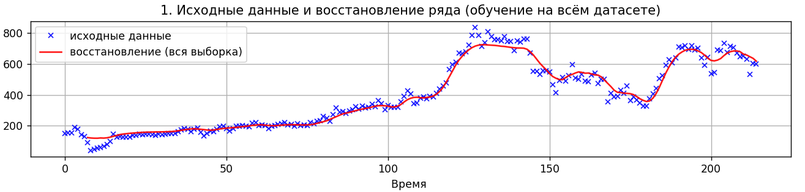
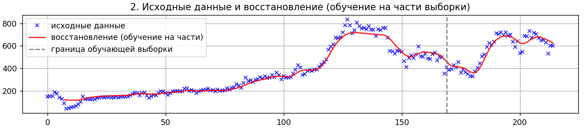
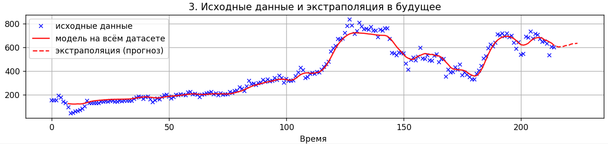
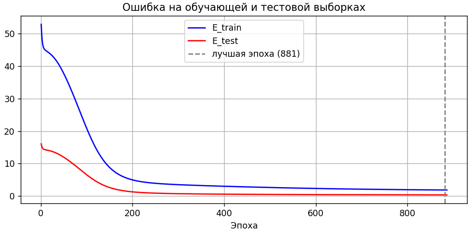
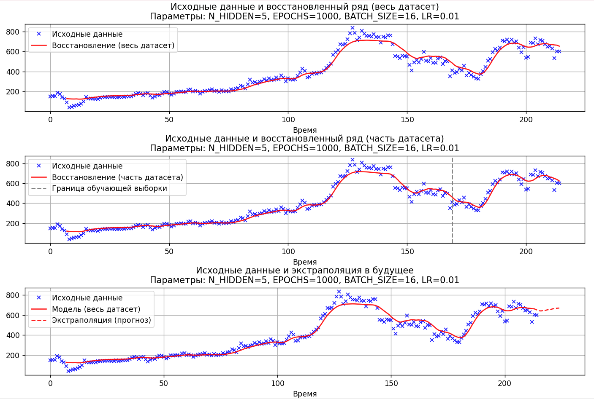
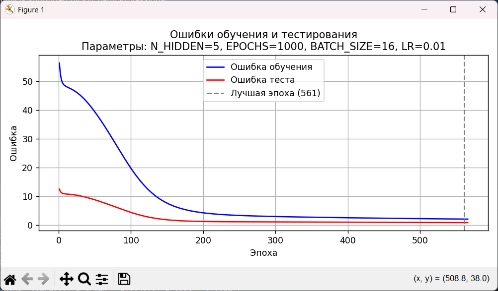
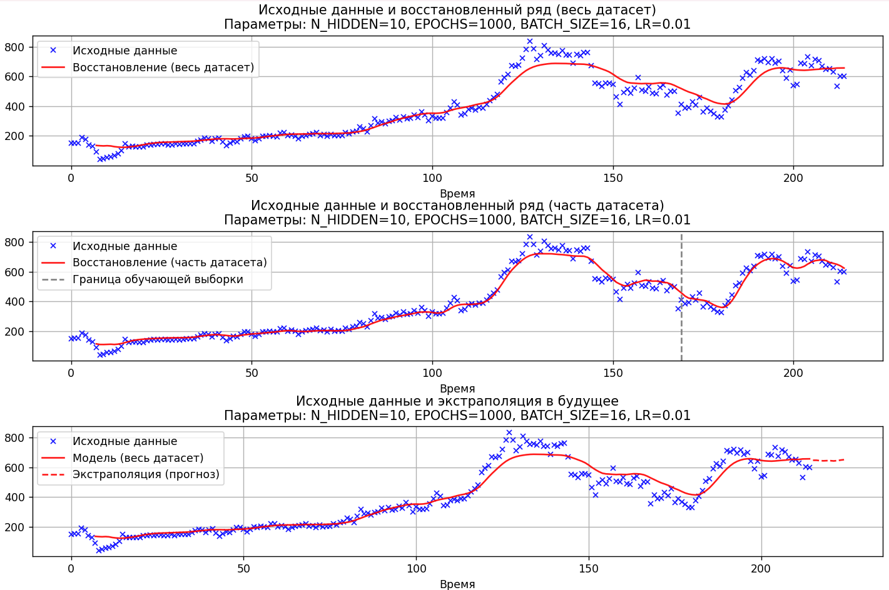
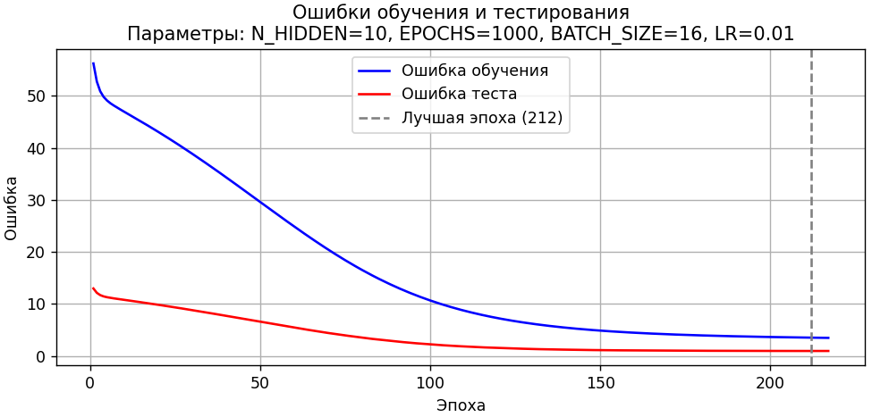

# Complex Perceptron for Stock Time Series Forecasting

Прогноз и восстановление временного ряда котировок акций **ПАО «Татнефть» (TATN)** с помощью сложного перцептрона (многослойной сети прямого распространения) на NumPy.

Реализованы с нуля: нормировка ряда, скользящее окно с перекрёстными точками, forward pass, backpropagation, обучение мини-батчами и ранняя остановка по тестовой ошибке.

## Возможности

- сложный перцептрон с одним скрытым слоем и нейронами смещения
- сигмоидальная активация и аналитический backpropagation
- мини-батчи, train/test split и early stopping
- восстановление ряда и итеративная экстраполяция в будущее
- набор экспериментов с гиперпараметрами

## Структура проекта

```text
.
├── complex_perceptron.py      # основная модель и визуализация
├── parameter_experiments.py   # эксперименты с гиперпараметрами
├── TATN.xlsx                  # котировки TATN
├── assets/results/            # графики результатов
├── requirements.txt
└── README.md
```

## Быстрый старт

```bash
python -m venv .venv
# Windows:
.venv\Scripts\activate
# Linux / macOS:
# source .venv/bin/activate

pip install -r requirements.txt
python complex_perceptron.py
```

Дополнительно (сравнение гиперпараметров):

```bash
python parameter_experiments.py
```

## Параметры по умолчанию

| Параметр | Значение | Смысл |
|---|---:|---|
| $N_{IN}$ | 10 | размер входного окна |
| $N_{HIDDEN}$ | 5 | нейроны скрытого слоя |
| $N_{OUT}$ | 5 | размер выходного окна |
| $N_{CROSS}$ | 3 | число перекрёстных точек |
| $\Delta$ | 0.05 | отступ нормировки от 0 и 1 |
| $\lambda$ | 0.01 | шаг градиентного спуска |
| epochs | 1000 | максимум эпох |
| batch size | 16 | размер мини-батча |
| train ratio | 0.8 | доля обучающей выборки |
| patience | 5 | ранняя остановка |
| future steps | 10 | длина прогноза вперёд |

---

## Теория

### 1. Нейрон и функция активации

Искусственный нейрон - базовый вычислительный элемент нейронной сети. Биологическим прообразом служит нейрон ЦНС: выход зависит от входа.

Каждый нейрон суммирует входящие сигналы $S_i$:

$$
S = \sum_i S_i \tag{1}
$$

Суммарный сигнал пропускается через функцию активации $f$:

$$
x = f(S) \tag{2}
$$

В проекте используется сигмоида:

$$
\sigma(S) = \frac{1}{1 + e^{-S}} \tag{3}
$$

Свойства: при $S \to +\infty$ значение $\sigma(S) \to 1$; при $S \to -\infty$ значение $\sigma(S) \to 0$; при $S = 0$ значение $\sigma(S) = 1/2$. Сигмоида плавно переходит из 0 в 1, что удобно для градиентного обучения.

Производная сигмоиды:

$$
\sigma'(S) = \sigma(S)\,(1 - \sigma(S)) \tag{4}
$$

### 2. Нейронный слой и перцептрон

Нейронный слой - набор одинаковых нейронов без связей внутри слоя. При передаче от слоя $i$ к слою $j$ каждый нейрон связан с каждым; веса образуют матрицу $W_{ij}$.

Вход нейрона $\bar{j}$:

$$
S_{\bar{j}} = \sum_i x_i W_{\bar{i}\bar{j}} \tag{5}
$$

Выход:

$$
y_{\bar{j}} = f(S_{\bar{j}}) \tag{6}
$$

Для корректной работы при нулевых входах добавляется нейрон смещения (bias) с выходом $1$:

$$
S_{\bar{j}} = \sum_i x_i W_{\bar{i}\bar{j}} + W_{1i\bar{j}} \tag{7}
$$

Даже при всех $x_i = 0$ сигнал равен обучаемому весу смещения. Bias сдвигает порог активации влево или вправо.

### 3. Архитектура сложного перцептрона

Сложный перцептрон (feed-forward сеть) отличается от простого наличием одного или нескольких скрытых слоёв. Скрытый слой не имеет прямой интерпретации; число нейронов в нём выбирается экспериментально.

Архитектура по умолчанию:

- входной слой: $N_{IN} = 10$
- скрытый слой: $N_{HIDDEN} = 5$
- выходной слой: $N_{OUT} = 5$

Матрицы весов:

- $W_1$ размера $(N_{IN} + 1) \times N_{HIDDEN}$ - связи вход $\to$ скрытый
- $W_2$ размера $(N_{HIDDEN} + 1) \times N_{OUT}$ - связи скрытый $\to$ выход

Нейрон смещения входит в обе матрицы.

**Прямой прогон (forward pass):** сигнал идёт слева направо; для каждой пары слоёв считаются $S$ и $x$ по формулам $(7)$ и $(6)$.

Схема прямого прогона:

$$
\tilde{X} = [1 \mid X]
\quad\to\quad
S_h = \tilde{X}\,W_1
\quad\to\quad
A_h = \sigma(S_h)
$$

$$
\tilde{X}_h = [1 \mid A_h]
\quad\to\quad
S_{out} = \tilde{X}_h\,W_2
\quad\to\quad
A_{out} = \sigma(S_{out})
$$

### 4. Целевая функция

Для одного образца датасета ошибка - сумма квадратов отклонений по выходным нейронам $k$:

$$
E(\{W\}) = \sum_k (t_k - x_k)^2 \tag{8}
$$

где $t_k$ - эталон, $x_k$ - выход сети.

Суммарная ошибка по датасету:

$$
E_\Sigma(\{W\}) = \sum_d E_d(\{W\}) \tag{9}
$$

### 5. Градиентный спуск

Обновление весов:

$$
\{W\}' = \{W\} - \nabla E \tag{10}
$$

где $\nabla E$ - градиент целевой функции по параметрам $\{W\}$. Нужно вычислить частные производные $\partial E / \partial W$ для каждого элемента каждой матрицы весов.

### 6. Алгоритм обратного распространения ошибки

Производные считаются справа налево: от выходного слоя к входному. Рассмотрим слои $\ldots \to q \to p \to k$, где $k$ - выходной.

#### Шаг 1. Градиент последней матрицы $W_{\bar{p}\bar{k}}$

По правилу цепочки:

$$
\frac{\partial E}{\partial W_{\bar{p}\bar{k}}}
=
\frac{\partial E}{\partial S_{\bar{k}}}
\cdot
\frac{\partial S_{\bar{k}}}{\partial W_{\bar{p}\bar{k}}} \tag{11}
$$

Правый множитель:

$$
\frac{\partial S_{\bar{k}}}{\partial W_{\bar{p}\bar{k}}} = x_{\bar{p}} \tag{12}
$$

Отсюда:

$$
\frac{\partial E}{\partial W_{\bar{p}\bar{k}}}
=
\frac{\partial E}{\partial S_{\bar{k}}} \cdot x_{\bar{p}} \tag{13}
$$

Ошибка нейрона $k$ снова через цепочку:

$$
\frac{\partial E}{\partial S_{\bar{k}}}
=
\frac{\partial E}{\partial x_{\bar{k}}}
\cdot
\frac{\partial x_{\bar{k}}}{\partial S_{\bar{k}}} \tag{14}
$$

Второй множитель - производная активации в точке $S_{\bar{k}}$. Первый берётся из $(8)$, так как $x_{\bar{k}}$ явно входит в целевую функцию:

$$
\frac{\partial E}{\partial S_{\bar{k}}}
=
\frac{\partial E}{\partial x_{\bar{k}}}
\cdot
\left.\frac{\partial f}{\partial S}\right|_{S = S_{\bar{k}}} \tag{15}
$$

Для градиента последней матрицы достаточно знать $x_{\bar{p}}$ и $\partial E / \partial S_{\bar{k}}$.

#### Шаг 2. Производная по элементу $W_{\bar{q}\bar{p}}$ (слой левее)

$$
\frac{\partial E}{\partial W_{\bar{q}\bar{p}}}
=
\frac{\partial E}{\partial S_{\bar{p}}}
\cdot
\frac{\partial S_{\bar{p}}}{\partial W_{\bar{q}\bar{p}}} \tag{16}
$$

$$
\frac{\partial S_{\bar{p}}}{\partial W_{\bar{q}\bar{p}}} = x_{\bar{q}} \tag{17}
$$

$$
\frac{\partial E}{\partial W_{\bar{q}\bar{p}}}
=
\frac{\partial E}{\partial S_{\bar{p}}} \cdot x_{\bar{q}} \tag{18}
$$

Вес $W_{\bar{q}\bar{p}}$ влияет на нейрон $\bar{p}$, а через него - на все нейроны слоя $k$, поэтому:

$$
\frac{\partial E}{\partial S_{\bar{p}}}
=
\sum_k
\frac{\partial E}{\partial S_k}
\cdot
\frac{\partial S_k}{\partial S_{\bar{p}}} \tag{19}
$$

$$
\frac{\partial S_k}{\partial S_{\bar{p}}}
=
\frac{\partial S_k}{\partial x_{\bar{p}}}
\cdot
\frac{\partial x_{\bar{p}}}{\partial S_{\bar{p}}} \tag{20}
$$

$$
\frac{\partial S_k}{\partial x_{\bar{p}}} = W_{\bar{p}k} \tag{21}
$$

Подставляя $(20)$ и $(21)$ в $(19)$ и вынося производную активации:

$$
\frac{\partial E}{\partial S_{\bar{p}}}
=
\left.\frac{\partial f}{\partial S}\right|_{S = S_{\bar{p}}}
\sum_k
\frac{\partial E}{\partial S_k}\, W_{\bar{p}k} \tag{22}
$$

Это ключевое соотношение: ошибка $\partial E / \partial S_k$ выходного слоя передаётся на предыдущий слой теми же весами, что использовались при прямом прогоне - отсюда название **обратное распространение ошибки** (error backpropagation).

#### Шаг 3. Сдвиг индексов

Для следующей матрицы формулы те же со сдвигом индексов на один слой влево:

$$
\frac{\partial E}{\partial W_{\bar{m}\bar{q}}}
=
x_{\bar{m}}
\cdot
\left(\frac{\partial E}{\partial S}\right)_{\bar{q}} \tag{23}
$$

$$
\left(\frac{\partial E}{\partial S}\right)_{\bar{q}}
=
\left.\frac{\partial f}{\partial S}\right|_{S = S_{\bar{q}}}
\sum_p
\left(\frac{\partial E}{\partial S}\right)_p W_{\bar{q}p} \tag{24}
$$

Зная вектор $\partial E / \partial S$ одного слоя, можно получить такой же вектор для слоя левее. Структура сохраняется для любого числа слоёв.

#### Шаг 4. Итоговый алгоритм

1. **Прямой прогон** (слева направо): подать вход, последовательно вычислить $S$ и $x$ по $(7)$ и $(6)$, сохранить $S$, $x$ и $\partial f / \partial S$.
2. **Обратный прогон** (справа налево): найти $\partial E / \partial S$ для выхода по $(14)$-$(15)$; двигаясь влево, считать $\partial E / \partial S$ по $(22)$; затем для каждой матрицы получить градиент по $(13)$ и $(18)$.

Суммируя градиенты по элементам мини-батча, получаем $\partial E / \partial W$ и делаем шаг $(10)$.

Суммарный градиент по датасету:

$$
\frac{\partial E_\Sigma}{\partial \{W\}}
=
\sum_d
\frac{\partial E_d}{\partial \{W\}} \tag{25}
$$

### 7. Мини-батчи и контроль переобучения

Датасет делится на мини-батчи. Внутри батча для каждого образца $d$ независимо считается $\partial E_d / \partial \{W\}$. После батча производные суммируются по $(25)$, затем выполняется один шаг $(10)$.

Для контроля переобучения выборка делится на обучающую и тестовую. На тесте веса не обновляются: пока модель обобщает, $E_{test}$ убывает вместе с $E_{train}$; при переобучении $E_{test}$ растёт, а $E_{train}$ продолжает падать. Оптимальная точка остановки - минимум $E_{test}$. В коде: ранняя остановка, если $E_{test}$ не улучшается `patience = 5` эпох подряд.

### 8. Датасет: скользящее окно и нормировка

Датасет строится скользящим окном. На вход подаётся $N_{IN}$ точек, на выход - $N_{OUT}$ точек. $N_{CROSS}$ точек одновременно входят и во вход, и в цель (перекрёстные). Шаблон сдвигается на 1 точку вправо.

При $N_{IN} = 10$, $N_{OUT} = 5$, $N_{CROSS} = 3$: вход - точки $1$-$10$, выход - точки $8$-$13$ (из них $8$-$10$ перекрёстные, $11$-$13$ - будущие).

Нормировка в диапазон $[\Delta,\, 1 - \Delta]$:

$$
z = \Delta + \frac{x - x_{min}}{x_{max} - x_{min}}\,(1 - 2\Delta) \tag{26}
$$

Параметр $\Delta = 0.05$ не даёт данным попадать в насыщенные зоны сигмоиды у $0$ и $1$, где градиент мал. Обратная нормировка:

$$
x = \frac{z - \Delta}{1 - 2\Delta}\,(x_{max} - x_{min}) + x_{min} \tag{27}
$$

---

## Результаты

### Восстановление ряда (обучение на всём датасете)

Красная линия модели близко следует исходным точкам. Наибольшие отклонения - в зонах резкой смены тренда.



### Восстановление при обучении на 80% выборки

Вертикальная пунктирная линия - граница обучающей части. В тестовой зоне отклик остаётся адекватным.



### Экстраполяция в будущее

Прогноз на `FUTURE_STEPS = 10` точек. Итеративное использование собственных предсказаний как входа ведёт к накоплению погрешности и выходу на квазистационарный режим - ожидаемое ограничение архитектуры.



### Кривые ошибки train / test

Обе ошибки убывают на старте. При начале переобучения $E_{test}$ перестаёт снижаться (и может расти), а $E_{train}$ продолжает падать. Вертикальная линия - оптимальная эпоха остановки.



### Эксперименты с гиперпараметрами

Базовый прогон (`N_HIDDEN=5`, `LR=0.01`, `EPOCHS=1000`, `BATCH_SIZE=16`):





Увеличенное число нейронов в скрытом слое (`N_HIDDEN=10`):





## Выводы

- Сложный перцептрон с одним скрытым слоем способен восстанавливать локальную динамику ряда TATN.
- Early stopping по расхождению $E_{train}$ и $E_{test}$ помогает зафиксировать момент переобучения.
- Долгосрочная итеративная экстраполяция выходит на квазистационарный режим из-за накопления ошибки - типичное ограничение компактной feed-forward архитектуры без рекуррентной памяти.

## Стек

- Python 3.10+
- NumPy - линейная алгебра и обучение
- pandas / openpyxl - загрузка Excel
- Matplotlib - визуализация
